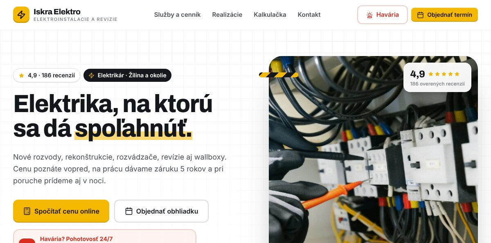

<p align="center">
  
</p>

<p align="center">
  Websites and web apps by <strong>Darien Ďalog</strong>, a freelance web developer in Bratislava, Slovakia.<br />
  <a href="https://donny-digital.com">donny-digital.com</a>
</p>

---

This repository holds my studio site and three working demo sites I built to show small businesses what a modern website can do for them: take bookings, orders and enquiries online instead of by phone.

The demos are for fictional businesses and say so on the site. Every flow works end to end in the browser, including accounts, availability, checkout and admin screens. Payments are simulated, and no e-mails or text messages are sent.

| Project | What it is | Live | Code |
|---|---|---|---|
| **Donny-Digital** | My studio site: services, case studies, process, and a contact form that sends through a serverless function | [donny-digital.com](https://donny-digital.com) | [`/`](src) and [`api/`](api) |
| **Aurelia** | Beauty salon with online booking, client accounts, loyalty and a staff admin | [salon.donny-digital.com](https://salon.donny-digital.com) | [`aurelia/`](aurelia) |
| **Lipa** | Restaurant and wine bar with table reservations and online ordering | [lipa.donny-digital.com](https://lipa.donny-digital.com) | [`lipa/`](lipa) |
| **Majster** | One codebase that generates a personalised website for any tradesperson from a single link | [elektro.donny-digital.com](https://elektro.donny-digital.com) | [`majster/`](majster) |

## Aurelia: salon booking

[](https://salon.donny-digital.com)

- **Booking flow** for several services in one visit, each with a chosen specialist or "anyone available"
- **Availability engine** that respects shifts, opening hours, holidays, other bookings, clean-up time and lead time
- **Deposits** for long services with a simulated card payment, plus reschedule and cancel rules
- **Client accounts** with loyalty tiers, points, rewards, referral codes and visit history
- **Staff admin** with KPIs, a day calendar per specialist, a client list with CSV export, and live price editing

Full feature list: [aurelia/README.md](aurelia/README.md)

## Lipa: restaurant reservations and ordering

[](https://lipa.donny-digital.com)

- **Table reservations** with live time-slot availability, seating areas and a manage-booking page
- **Online ordering** for pickup or delivery, with delivery zones, dish options, promo codes and gift-voucher balances at checkout
- **Daily lunch menu** that rotates by week, and a full menu with the 14 EU allergens and diet filters
- **Live opening status** and holiday hours everywhere on the site

Full feature list: [lipa/README.md](lipa/README.md)

## Majster: personalised sites for tradespeople

[](https://elektro.donny-digital.com)

- **Five trades from one codebase**: electrician, plumber, carpenter, tiler and painter, each with its own services, prices, photos and colours
- **Personalised links** that put a prospect's business name, town and phone number into the whole site, so they open "their" website
- **Subdomain routing**, so each trade gets a clean address
- **A link generator** that builds personalised links in bulk from a pasted list and exports them to CSV

Full feature list: [majster/README.md](majster/README.md)

## Stack

- React 19, TypeScript and Vite
- Tailwind CSS 4 and React Router 7
- Vercel hosting, with a Vercel Function and [Resend](https://resend.com) behind the contact form
- Mobile-first, responsive layouts

## Repository layout

```
/          donny-digital.com (studio site)
api/       serverless contact form (Vercel Function + Resend)
aurelia/   salon booking demo
lipa/      restaurant demo
majster/   tradesperson demo
docs/      images for this README
```

Each site is its own Vite app and deploys as a separate Vercel project, with the Root Directory set to its folder.

## Run locally

```bash
npm install
npm run dev            # studio site at http://localhost:5173

cd aurelia             # or lipa, or majster
npm install
npm run dev
```

The contact form needs `RESEND_API_KEY` and `CONTACT_TO_EMAIL` (optionally `CONTACT_FROM_EMAIL`) set as environment variables in Vercel. The demos need no configuration.

## Contact

For new projects, get in touch through [donny-digital.com/contact](https://donny-digital.com/contact).
